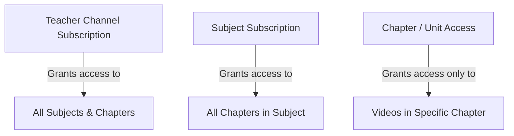
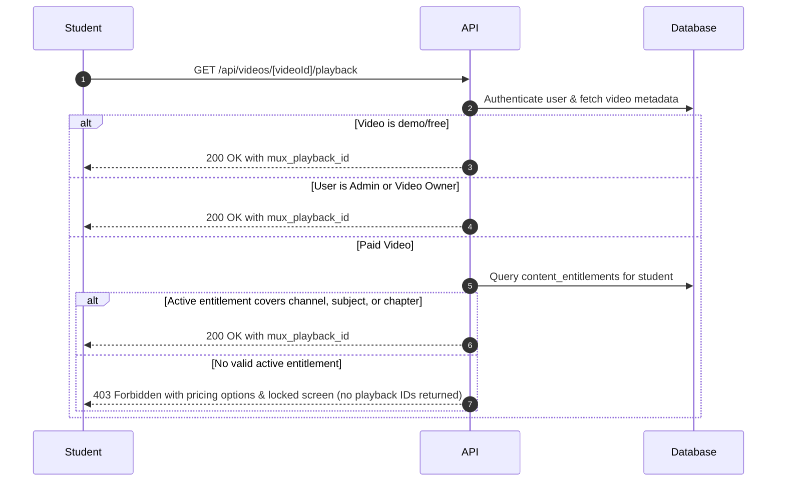
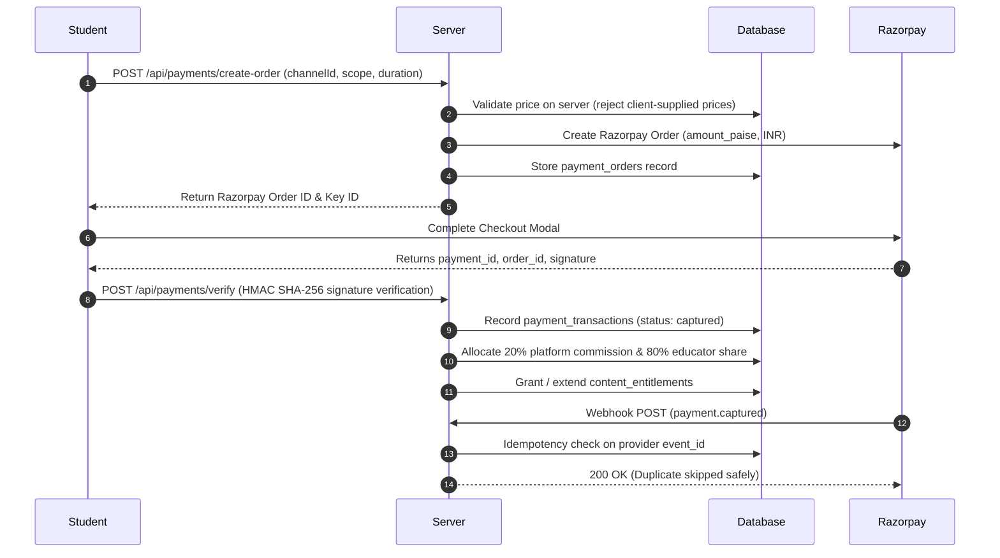

# Teacher Monetization, Paid Video Access, Subscriptions & Commission Architecture

## 1. Executive Summary

This document describes the production monetization architecture implemented for the EdTech platform. The system empowers educators to independently monetize content at three hierarchical levels (**Teacher Channel**, **Subject**, and **Chapter / Unit**) across three calendar durations (**1 Month**, **6 Months**, and **12 Months**). Every rupee is backed by strict database models, minor currency units (paise), a 20% platform commission policy, secure backend video playback gatekeeping, and official Razorpay checkout & webhook idempotency.

---

## 2. Monetization Hierarchy & Scopes

The platform enforces a three-tier access entitlement model:



### Access Levels:
1. **Teacher Channel (`channel`):**
   - Grants global playback access to all subjects, chapters, videos, quizzes, and homework owned by the educator.
2. **Subject (`subject`):**
   - Grants targeted access to all chapters and video lessons tagged with the purchased subject (e.g., Mathematics, Physics) within that channel.
3. **Chapter / Unit (`chapter`):**
   - Grants focused access exclusively to the specific curriculum unit (e.g., "Calculus - Unit 1: Limits & Continuity").

### Overlapping Entitlements Rule:
Access evaluation checks from broadest scope to most granular scope:
`Channel Entitlement -> Subject Entitlement -> Chapter Entitlement`.
If a student has an expired Chapter entitlement but an active Subject or Channel entitlement, access is **GRANTED**. Entitlements are evaluated across all valid non-expired records, never restricted solely to the latest purchase.

---

## 3. Subscription Durations & Calendar Expiry

The platform supports 3 fixed durations for all three scopes:
- **1 Month (`1_month`)**
- **6 Months (`6_months`)**
- **12 Months (`12_months`)**

### Calendar-Based Expiry Policy:
Instead of adding an arbitrary fixed number of seconds (which causes month-drifts), the system calculates true calendar month increments with month-end date clamping:
- **Jan 31 + 1 month (non-leap year):** Clamps to **Feb 28**.
- **Jan 31 + 1 month (leap year):** Clamps to **Feb 29**.
- **March 31 + 6 months:** Clamps to **September 30** (since September has 30 days).
- **Feb 29 (leap day) + 12 months:** Clamps to **Feb 28** of the following standard year.

### Renewal Policy:
- **Active Subscription Renewal:** Extends access by appending the new duration to the existing `expires_at` timestamp.
- **Expired Subscription Renewal:** Starts immediately from the current server timestamp (`now()`) and applies the calendar duration.

---

## 4. 20% Platform Fee Surcharge Model & Accounting

### Financial Policy:
- **Teacher Base Ask ($B$):** The educator sets the net price they wish to receive for their content (e.g. ₹1,000).
- **Platform Service Fee ($F$):** A **20%** platform fee is added on top of the teacher's ask ($F = \text{round}(B \times 0.20)$, e.g. ₹200).
- **Student Total Payable ($G$):** The student pays the gross total ($G = B + F$, e.g. ₹1,200).
- **Educator Payout:** When payment is verified, the educator receives **100% of their base ask** ($B = \text{round}(G / 1.20) = \text{₹1,000}$), and the platform retains the 20% fee ($F = G - B = \text{₹200}$).
- **Unit of Account:** Integer minor units (**paise**, where ₹1 = 100 paise).
- **Discrepancy Guarantee:** Zero floating-point drift. Commission decomposition enforces `teacherSharePaise + platformCommissionPaise === grossPaise` down to the exact paise.

### Independent Pricing by Scope:
- **Per Channel:** Educators can set independent monthly, 6-month, and 12-month prices for full channel access.
- **Per Chapter (Unit):** Educators can set distinct, independent prices for each curriculum unit/chapter, allowing micro-transactions for individual chapters.
- **Per Subject:** Educators can price each subject independently within their channel.

### Illustrative Pricing & Allocations:
| Teacher Base Ask (₹) | Platform Fee (+20%) (₹) | Student Total Pays (₹) | Gross (Paise) | Educator Share (Paise) | Platform Fee (Paise) | Remainder |
| :--- | :--- | :--- | :--- | :--- | :--- | :--- |
| ₹100.00 | ₹20.00 | **₹120.00** | 12,000 | 10,000 (₹100) | 2,000 (₹20) | 0 paise |
| ₹299.00 | ₹59.80 | **₹358.80** | 35,880 | 29,900 (₹299) | 5,980 (₹59.80) | 0 paise |
| ₹500.00 | ₹100.00 | **₹600.00** | 60,000 | 50,000 (₹500) | 10,000 (₹100) | 0 paise |
| ₹1,000.00 | ₹200.00 | **₹1,200.00** | 120,000 | 100,000 (₹1,000) | 20,000 (₹200) | 0 paise |
| ₹2,500.00 | ₹500.00 | **₹3,000.00** | 300,000 | 250,000 (₹2,500) | 50,000 (₹500) | 0 paise |

---

## 5. Secure Video Access & Mux Playback Protection

### Security Vulnerability Eliminated:
Previously, video playback IDs or signed URLs were directly returned to the frontend by client queries.

### New Gatekeeper Architecture:
All video playback credentials must be retrieved through the backend authorization gatekeeper at:
`GET /api/videos/[videoId]/playback`



---

## 6. Razorpay Payment Lifecycle & Idempotency



---

## 7. Database Migration & Schema

The SQL migration is located at:
`supabase/teacher_monetization_schema.sql`

### Tables Created / Extended:
1. `public.teacher_content_pricing`: Stores scope (`channel`, `subject`, `chapter`), durations, amounts in paise, and teacher ownership.
2. `public.content_entitlements`: Stores student grants with exact calendar `starts_at` and `expires_at`, scope, and order references.
3. `public.teacher_pricing_audit`: Immutable audit trail of every price change with actor ID, old price, new price, and change reason.
4. `public.channel_subscriptions`: Extended with `expires_at`, `duration`, `unit_id`, and `order_id` for backward compatibility.

---

## 8. Dashboard Integrations

### A. Teacher Dashboard:
- **Monetization Center (`/teacher/monetization`):**
  - **Section A:** Channel Pricing (1mo, 6mo, 12mo) with live student preview.
  - **Section B:** Subject Pricing for all authorized subjects.
  - **Section C:** Chapter Pricing for all eligible curriculum units.
- **Earnings & Ledger (`/teacher/earnings`):**
  - KPI cards: Gross Sales, Net Educator Earnings (80%), Platform Commission (20%), Active Subscriptions.
  - Breakdown by Scope (Channel vs Subject vs Chapter) and Duration.
  - Searchable transaction ledger.

### B. Super Admin Dashboard (`/admin/payments`):
- Complete financial visibility across all teachers and students.
- Searchable & filterable ledger by Scope (`all`, `channel`, `subject`, `chapter`) and Status (`captured`, `failed`, `refunded`).
- Full Transaction Details Modal displaying student ID, educator ID, order IDs, provider references, and paise reconciliation.
- **CSV Export:** One-click export of the complete financial transaction ledger for auditing.

### C. Student Experience:
- **Watch Page (`/watch/video/[videoId]`):** Locked screen with duration selector, level selector, and instant Razorpay unlock.
- **Channel Page (`/channels/[channelId]`):** Subscribe modal with live duration and scope selection.

---

## 9. Automated Testing Commands

Execute the test suites via Node.js:

```bash
# 1. Run Teacher Monetization, Commission & Entitlement Tests (35 tests)
node tests/test_teacher_monetization.js

# 2. Run Razorpay Payment Lifecycle & Signature Tests (21 tests)
node tests/test_payment_lifecycle.js
```

---

## 10. Environment Variables Required

Configure these environment variables in `.env` (use `.env.example` as a template):

```ini
# Supabase
NEXT_PUBLIC_SUPABASE_URL=https://your-project.supabase.co
NEXT_PUBLIC_SUPABASE_ANON_KEY=your-anon-key
SUPABASE_SERVICE_ROLE_KEY=your-service-role-key

# Razorpay
RAZORPAY_KEY_ID=rzp_test_or_live_key
RAZORPAY_KEY_SECRET=your_razorpay_secret
RAZORPAY_WEBHOOK_SECRET=your_webhook_secret

# Mux Video
MUX_TOKEN_ID=your_mux_token_id
MUX_TOKEN_SECRET=your_mux_token_secret
```
